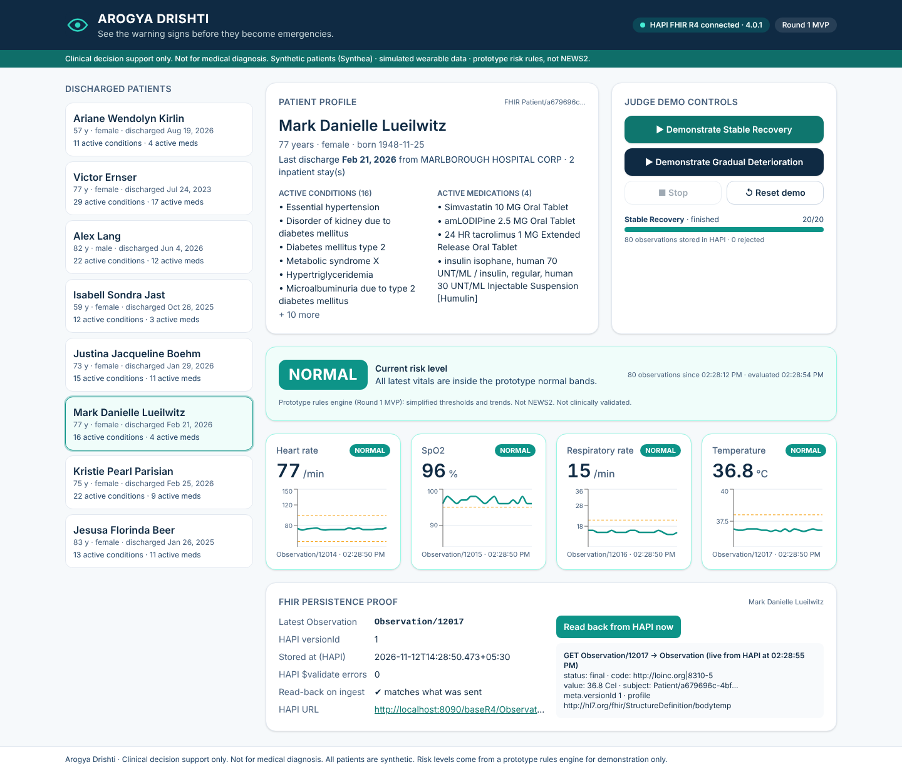
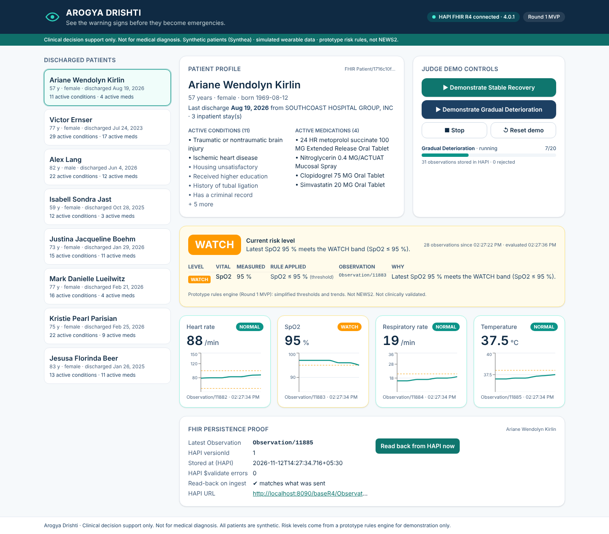
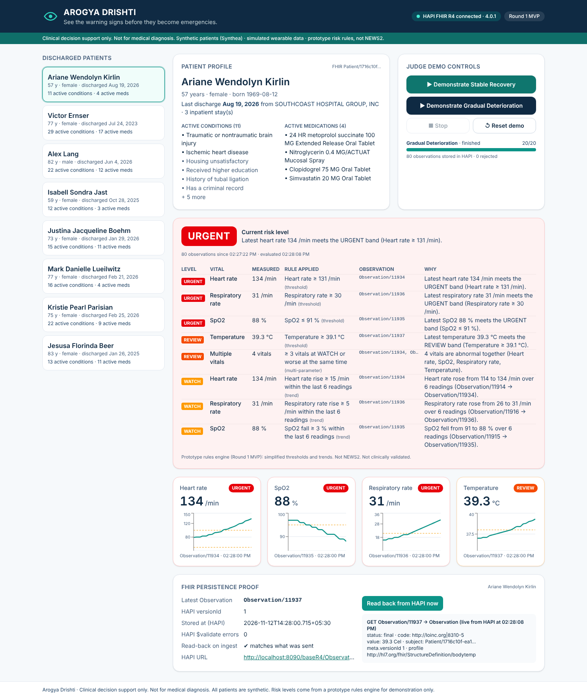
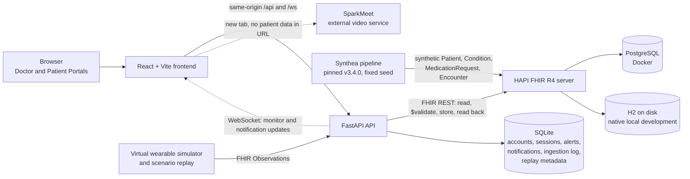
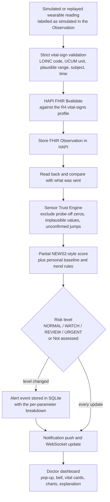
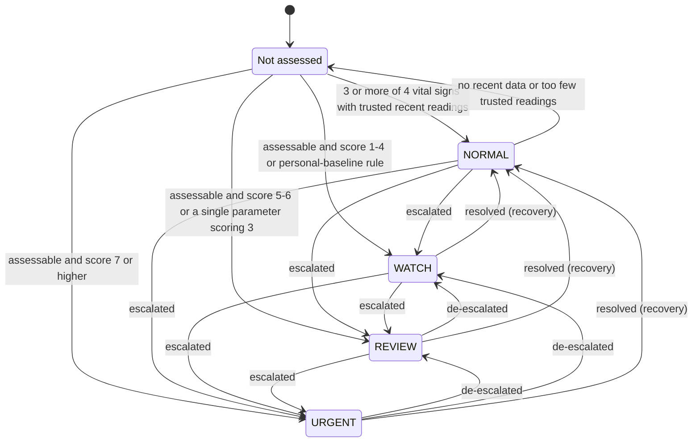
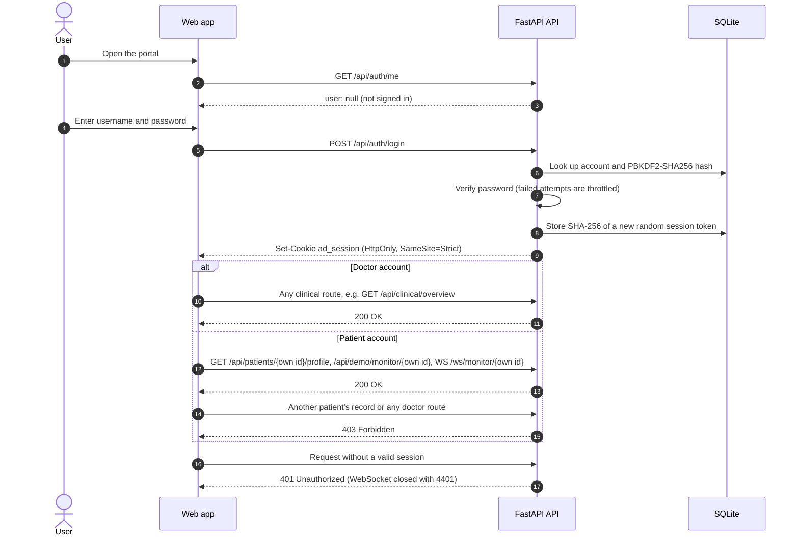

<div align="center">

# Arogya Drishti

### See the warning signs before they become emergencies.

**A personalized post-discharge deterioration monitoring platform**, built for **MineArena 1.0, problem statement PS-03**.

[](https://react.dev/)
[](https://www.typescriptlang.org/)
[](https://fastapi.tiangolo.com/)
[](https://www.python.org/)
[](https://hapifhir.io/)
[](https://developer.mozilla.org/docs/Web/API/WebSockets_API)
[-2496ED?logo=docker&logoColor=white)](DEPLOYMENT.md)
[](#testing-and-verification)

> **Clinical decision support only. Not for medical diagnosis.**
> All patients are synthetic (Synthea) and all vital signs are simulated or replayed. Not clinically validated.

</div>

---

## Contents

- [The problem](#the-problem) · [The solution](#the-solution) · [Key features](#key-features) · [Video consultation](#video-consultation)
- [Screenshots](#screenshots) · [Architecture](#architecture) · [Monitoring flow](#monitoring-flow) · [Risk states](#risk-states) · [Sign-in and authorization](#sign-in-and-authorization)
- [Data ownership](#data-ownership) · [Technology stack](#technology-stack)
- [Run it locally](#run-it-locally) · [Docker](#docker) · [Demo walkthrough](#demo-walkthrough)
- [API overview](#api-overview) · [Project structure](#project-structure) · [Testing and verification](#testing-and-verification)
- [Safety, privacy and limitations](#safety-privacy-and-limitations) · [Roadmap](#roadmap) · [Documentation](#documentation) · [Contributors](#contributors) · [License](#license)

---

## The problem

The days and weeks after a hospital discharge are a vulnerable period. A patient recovering at home can deteriorate gradually: oxygen saturation slips, breathing quickens, heart rate climbs, a fever develops. Each change on its own can look minor, and nobody is watching continuously. By the time symptoms are obvious, the situation may already be an emergency.

Fixed alarm thresholds do not solve this well. They ignore what is normal for a particular patient, they react late to slow trends, and a loose or disconnected sensor can trigger a stream of false alarms that teach clinicians to ignore alerts.

## The solution

Arogya Drishti watches a discharged patient's vital signs, compares them with that patient's own history and clinical context, and tells a clinician early and in plain language when something is changing.

1. **Live vital signs** (heart rate, SpO₂, respiratory rate, body temperature) arrive from a virtual wearable or a replayed scenario.
2. Every reading is **validated and stored as a FHIR R4 Observation** in a HAPI FHIR server, next to the patient's synthetic FHIR record (conditions, medications, discharge encounter).
3. A **Sensor Trust Engine** sets aside readings that look like sensor faults (probe-off zeros, implausible values, unconfirmed spikes).
4. A **deterministic, explainable risk engine** combines a partial NEWS2-style score with **personal baselines** and trend rules to classify the patient as **NORMAL, WATCH, REVIEW or URGENT**.
5. Changes in risk level become **alerts** that reach the doctor in real time (pop-ups, a notification bell, optional tones) with an explanation of which readings drove the decision.
6. A **clinician reviews and acknowledges** the alert. The system supports the decision; it never makes it.

No machine-learning model or external AI service makes clinical decisions: every rule is visible, tested and traceable to the stored readings.

---

## Key features

<table>
<tr><td valign="top" width="50%">

**Portals and access**
- **Doctor Portal**: dashboard with live patient counts, patient directory, per-patient monitoring, alerts, data management, labs and video consultation.
- **Patient Portal**: *My Health*, *My Health Trends*, *My Medical Records*, *My Profile* and *Video Consultation*.
- **Secure role-based sign-in**: per-account random passwords stored as PBKDF2-SHA256 hashes; HttpOnly, SameSite=Strict session cookies.
- **Patient-specific access restrictions**: a patient account can read only its own profile and live readings; the server enforces this for HTTP and WebSocket requests.

**Monitoring**
- **Patient directory** with search by name, status filter (risk level, monitoring status) and sorting (risk, name, most recent reading).
- **Live monitoring** of heart rate, SpO₂, respiratory rate and body temperature, with latest value, timestamp, trend and stale/unavailable states.
- **Interactive trend charts** (Recharts) with hover tooltips, time-range filters and the patient's personal baseline.
- **Personalized deterioration assessment**: partial NEWS2-style scoring (4 of 7 parameters) plus per-patient median/MAD baselines and trend rules.
- **Plain-language risk explanations** naming each vital sign, its reading and its score, with technical details (FHIR ids, LOINC codes, bands) in a collapsible section.
- **NORMAL / WATCH / REVIEW / URGENT** states, plus an honest **Not assessed** state when there are too few recent trusted readings.
- **Sensor Trust Engine**: probe-off zeros, implausible values and unconfirmed jumps are excluded from scoring and reported as sensor-quality issues.
- **SpO₂ Scale 2 configuration**: recorded as a FHIR `Flag` with clinician name and reason; never inferred from a diagnosis.

</td><td valign="top" width="50%">

**Alerts**
- **Real-time notifications** over WebSocket (with polling fallback): severity-coloured pop-ups on every Doctor Portal page and a bell with an **unread count**.
- **Alert acknowledgement**: recorded per doctor account with a timestamp; read, acknowledged and dismissed are kept separate, and the alert itself is never modified.
- **Audible alert tones** (Web Audio): one beep for WATCH, two for REVIEW, three faster beeps for URGENT, with an on/off toggle and a test button.

**Simulation, replay and evaluation**
- **Virtual wearable simulation** with **Stable Recovery** and **Gradual Deterioration** scenarios, started from the patient page and stored through the normal ingestion pipeline.
- **Replay** of seeded scenarios (including sensor-artifact variants) at 1×, 5×, 10× or batch speed, with pause, resume, stop and reset.
- **Early Detection Lab**: the personalized engine and a clearly labelled fixed-threshold comparator process the same stored readings; first-detection times and the measured difference are shown.
- **Sensor Reliability Lab**: false clinical alerts of the fixed-threshold comparator versus the Sensor Trust Engine, counted against the scenario's labels.
- **Evidence and evaluation endpoints** computing metrics from stored data.

**Data and interoperability**
- **FHIR validation, persistence and inspection**: strict local validation, HAPI `$validate`, storage and read-back verification; an inspector shows what HAPI holds.
- **Synthetic Synthea cohort** of eight discharged patients (pinned Synthea v3.4.0, fixed seed).
- **Add Patient** (FHIR `Patient` + discharge `Encounter`) and explicit **Patient Portal login creation** with a one-time random password.
- **CSV import** of patient records or vital-sign observations (fully validated first; nothing is written if any row is invalid) and **CSV export** of the directory, a patient record or a vital-sign history.
- **Video Consultation** entry points in both portals (see below).

</td></tr>
</table>

---

## Video consultation

Both the Doctor Portal (sidebar item and a **Start Video Consultation** button on each patient page) and the Patient Portal (**Join Video Consultation**) provide a video consultation entry point.

| | |
|---|---|
| **Service** | An external video application, **SparkMeet**, opened in a new browser tab (`target="_blank"`, `rel="noopener noreferrer"`). It is not hosted or operated by Arogya Drishti. |
| **Default URL** | `https://sparkmeet-web.onrender.com/` (from `apps/web/src/brand.ts`) |
| **Configuration** | Set `VITE_SPARKMEET_URL` at build/dev time to point to another deployment. |
| **Privacy boundary** | Arogya Drishti puts **no patient identifiers, names, medical details or session tokens** in the URL. |
| **Scope** | Arogya Drishti does **not** create meeting rooms, send invitations or pair doctors and patients; rooms and invitations are handled inside SparkMeet. |

---

## Screenshots

These screenshots were captured from the **Round 1 prototype dashboard** during a live simulation against a local HAPI FHIR server. The current interface has since been reorganised into the Doctor and Patient Portals with the personalized risk engine, but the monitoring concept is the same.

| Stable recovery: NORMAL | Gradual deterioration: WATCH | Gradual deterioration: URGENT |
|---|---|---|
| [](docs/screenshots/r1-stable-normal.png) | [](docs/screenshots/r1-deterioration-watch.png) | [](docs/screenshots/r1-deterioration-urgent.png) |
| A stable synthetic patient: every vital sign within range, readings stored in HAPI and read back. | SpO₂ drifts down to 95 %: the risk level rises to WATCH with the triggering rule and FHIR Observation shown. | Several vital signs are now abnormal: the patient is escalated to URGENT. |

---

## Architecture



- In development the Vite dev server proxies `/api`, `/health` and `/ws` to the API; in Docker an nginx container does the same, so the browser only ever talks to one origin.
- HAPI FHIR owns every clinical resource. The API's SQLite file stores only application metadata.
- See [docs/ARCHITECTURE.md](docs/ARCHITECTURE.md) for the component and process model.

---

## Monitoring flow



The risk engine reads the **stored readings** only. Scenario labels (for example where a scripted deterioration starts or where a sensor fault was injected) are kept separately and are used only by the evaluation and lab modules after detection has run. The engine never sees them, and an automated test enforces that the detector cannot import them.

---

## Risk states



| Level | Rule (partial NEWS2-style, 4 of 7 parameters) | Meaning shown to the doctor |
|---|---|---|
| **Not assessed** | fewer than 3 of 4 vital signs with trusted readings in the last 60 minutes | No status is invented; a NORMAL result is never shown without data. |
| **NORMAL** | aggregate 0 and no personal-baseline deviation | Readings consistent with the patient's expected range. |
| **WATCH** | aggregate 1–4, or a sustained deviation from the personal baseline | Concerning trend; continued monitoring recommended. |
| **REVIEW** | aggregate 5–6, or any single parameter scoring 3 | Multiple vital signs worsening; clinical review recommended. |
| **URGENT** | aggregate 7 or higher | Significant deterioration; prompt clinical assessment recommended. |

Every change of level is recorded as an alert event (`raised`, `escalated`, `de-escalated`, `resolved`). A safety floor ensures that a single parameter scoring 3 or an aggregate of 5 or more is never tolerated away by a personal baseline. The bands follow the published NEWS2 structure, but only four parameters are measured (consciousness, systolic blood pressure and supplemental oxygen are not), so this is **not a complete NEWS2 score and is not clinically validated**.

---

## Sign-in and authorization



Access is **deny-by-default** and enforced in one ASGI middleware for both HTTP and WebSocket traffic. Only health, status, metadata and the sign-in endpoints are public. The in-process simulator posts observations with a per-process internal token.

---

## Data ownership

| Store | Owns | Notes |
|---|---|---|
| **HAPI FHIR R4** | All clinical resources: `Patient`, `Condition`, `MedicationRequest`, `Encounter`, `Observation`, `Flag` | The single source of clinical truth. |
| **PostgreSQL** | HAPI's database in the Docker setup | Docker volume `hapi-db-data`. |
| **H2** (on disk) | HAPI's database in native local development | `.local/hapi/data`. |
| **SQLite** | Application metadata only: accounts (password hashes), sessions, risk state, alert events, notification read/acknowledgement records, ingestion log, replay sessions and scenario labels | `.local/api/app.db` locally, volume `api-data` in Docker. |
| **Generated credentials and runtime data** | `.local/` (including `.local/api/credentials.json`, mode 600) | Gitignored; never committed. |

Use only synthetic or de-identified demonstration data. Never load real patient records.

---

## Technology stack

| Layer | Technology | Role in Arogya Drishti |
|---|---|---|
| Frontend | **React 19** | Doctor and Patient Portal UI. |
| | **TypeScript** | Typed API client and components (`tsc --noEmit` in checks). |
| | **Vite** | Dev server with `/api` and `/ws` proxy; production build. |
| | **Tailwind CSS** | Navy/teal design system, responsive layouts. |
| | **Recharts** | Vital-sign trend charts, detection timelines. |
| Backend | **Python 3.10+** | API, risk engine, simulator, replay and evaluation. |
| | **FastAPI** | REST and WebSocket API, auth middleware, OpenAPI docs. |
| | **Uvicorn** | ASGI server for the API. |
| Clinical data | **HAPI FHIR R4** | FHIR server: storage, `$validate`, search. HAPI 5.7.0 CLI locally; `hapiproject/hapi` image in Docker. |
| | **PostgreSQL / H2** | HAPI's database (Docker / native local). |
| App data | **SQLite** | Accounts, sessions, alerts, notifications, ingestion log, replay metadata. |
| Real time | **WebSockets** | Live monitor frames and doctor notifications, with polling fallback. |
| Synthetic data | **Synthea** | Pinned generator for the eight-patient discharged cohort. |
| Packaging | **Docker Compose** | Container setup for database, HAPI, API, web and seeding (see status below). |

---

## Run it locally

The localhost-first workflow (no Docker) is the tested path. It has been run on Linux; the macOS setup path was exercised in a macOS-like environment.

**Requirements**

| Tool | Version |
|---|---|
| Python | 3.10 or newer (macOS ships 3.9, which is not supported) |
| Node.js | 20.19+ or 22.12+ (the web unit tests need 22.12+) |
| Java | 11, 17 or 21 for HAPI FHIR 5.7 and Synthea; `setup.sh` installs a private Java 17 if none is found |

**Start**

```bash
scripts/dev/setup.sh      # once: Python venv, web packages, Java check
scripts/dev/up.sh         # start HAPI FHIR, API and web in the background, then run the health check
scripts/dev/seed.sh       # generate (or reuse) the pinned Synthea cohort and load it into HAPI
scripts/dev/accounts.sh   # create the doctor account and one account per synthetic patient
scripts/dev/health.sh     # PASS / FAIL / BLOCKED per check
```

Stop everything with `scripts/dev/down.sh` (data in `.local/` is kept).

| URL | What |
|---|---|
| http://localhost:5173 | Web app (Doctor Portal `#/doctor`, Patient Portal `#/me`) |
| http://localhost:8000/docs | API documentation (OpenAPI) |
| http://localhost:8000/api/v1/status | Dependency status |
| http://localhost:8090/baseR4/metadata | HAPI FHIR CapabilityStatement |

`accounts.sh` prints the generated usernames and passwords once and writes them to `.local/api/credentials.json` (mode 600, gitignored). Passwords are random per account; re-running keeps existing accounts and `--reset` issues new ones. Never copy generated passwords into documentation or commits.

<details>
<summary><b>Configuration and useful extras</b></summary>

- Defaults come from `.env.local.example`; copy it to `.env.local` to override ports, `FHIR_BASE_URL`, `APP_SQLITE_PATH`, `HAPI_JAVA` and so on.
- `AUTH_REQUIRED` (default `true`) controls sign-in; `COOKIE_SECURE=true` marks the session cookie Secure when served over HTTPS.
- `MONITOR_RECENT_MINUTES` (default 60) and `MONITOR_STALE_MINUTES` (default 15) set the assessment window and the stale threshold.
- `VITE_SPARKMEET_URL` overrides the video consultation link; `VITE_DEV_API_TARGET` sets where Vite proxies API traffic.
- `scripts/dev/simulate.sh <patient-id> [stable|deterioration] [steps] [interval]` streams simulated readings from the terminal (signs in as the local doctor).
- `up.sh` skips services that are already running: run `down.sh` first after pulling new code.
- Developer tools (replay, evaluation, acceptance) are described in [docs/DEVELOPMENT.md](docs/DEVELOPMENT.md); HAPI's local setup is in [infra/hapi-local/README.md](infra/hapi-local/README.md).

</details>

---

## Docker

> **Status: untested.** `docker-compose.yml` and the Dockerfiles are kept in step with the code and validated as configuration, but no container has been built or started: container registries were unreachable from the build environment (see [DEPLOYMENT.md](DEPLOYMENT.md) and blocker B2 in [CHECKPOINTS.md](CHECKPOINTS.md)). Treat this path as a starting point, not a production deployment.

```bash
cp .env.example .env                       # then change POSTGRES_PASSWORD (Compose refuses to start without it)
docker compose up -d --build               # database → HAPI FHIR → API → web
docker compose ps
docker compose --profile seed run --rm synthea-import   # load the synthetic cohort into HAPI
docker compose exec api python -m app.auth provision    # create accounts after seeding (credentials in the api-data volume)
scripts/smoke.sh                           # API health, web proxy, HAPI is R4, API sees HAPI
```

| URL | What |
|---|---|
| http://localhost:8080 | Web app (nginx, proxies `/api` and `/ws` to the API) |
| http://localhost:8000/docs | API documentation |
| http://localhost:8090/fhir/metadata | HAPI FHIR CapabilityStatement |

Persistent volumes: `hapi-db-data` (PostgreSQL with all FHIR resources), `api-data` (SQLite application metadata and generated credentials) and `synthea-cache` (downloaded Synthea jar) survive `docker compose down`; `docker compose down -v` deletes them.

---

## Demo walkthrough

A judge-friendly flow of about five minutes, using the localhost setup.

1. **Sign in as the doctor** (credentials printed by `scripts/dev/accounts.sh`). The dashboard shows live patient counts and patients needing attention.
2. **Open the patient directory**, search or filter, and **choose a patient** (for example Alex Lang).
3. In the **Demo / Simulation** section, click **Reset Simulation**: the view clears and shows *Waiting for readings* (no invented NORMAL).
4. Select **Gradual Deterioration** and click **Start Simulation**. Watch the four vital cards and trend charts update every few seconds.
5. Observe the escalation **NORMAL → WATCH → REVIEW → URGENT**, with a pop-up (and tone, if enabled) at each change, even while browsing other pages.
6. Inspect the **risk explanation**: each vital sign, its reading, its score, the total and the classification band. Open the bell and **acknowledge** an alert.
7. Open **Technical details** to see the triggering FHIR Observation id and its read-back status, then read it straight from HAPI (`http://localhost:8090/baseR4/Observation/<id>`) or through `GET /api/inspector/observations/<id>`.
8. Optionally run **Stable Recovery** to show readings staying NORMAL, then the **Early Detection Lab** and **Sensor Reliability Lab** for the side-by-side comparisons.
9. **Sign in as a patient** in a private window: the Patient Portal shows only that patient's own readings and record; other patients' data returns 403.
10. Click **Video Consultation** and explain the boundary: it opens the external SparkMeet service in a new tab, without patient data in the URL.

---

## API overview

All routes are served by `apps/api/app/main.py`. Except where marked public, routes require a signed-in doctor; patient accounts may use only the routes marked *own record*.

<details>
<summary><b>Endpoint reference</b></summary>

| Group | Method and path | Purpose |
|---|---|---|
| **Authentication** (public) | `POST /api/auth/login` · `POST /api/auth/logout` · `GET /api/auth/me` | Sign in, sign out, current session |
| **Health / status** (public) | `GET /health` · `GET /api/v1/meta` · `GET /api/v1/status` | Liveness, product metadata, dependency status |
| **Patients** | `GET /api/patients` | Monitored patients (Synthea cohort and portal-registered) |
| | `GET /api/patients/{id}/profile` | Demographics, discharge, conditions, medications (*own record* for patients) |
| | `POST /api/patients` | Register a patient (FHIR Patient + discharge Encounter) |
| | `GET /api/patients/{id}/account` · `POST /api/patients/{id}/account` | Patient Portal login status / create or reset (one-time password) |
| | `GET /api/patients/{id}/scale2` · `POST …/scale2` · `DELETE …/scale2` | SpO₂ Scale 2 status / record (clinician + reason) / clear |
| **FHIR observations** | `POST /api/fhir/Observation` | Ingest: strict validation, HAPI `$validate`, store, read back |
| | `GET /api/fhir/Observation` · `GET /api/fhir/Observation/{id}` | Search / read observations |
| **Monitoring** | `GET /api/demo/monitor/{id}` | Live monitor: vitals, risk, explanation, assessment (*own record* for patients) |
| | `GET /api/clinical/overview` · `GET /api/monitoring/status` | Directory overview with risk levels / monitoring-source status |
| **Simulator** | `GET /api/demo/simulator` · `POST /api/demo/simulator/start` · `POST /api/demo/simulator/stop` · `POST /api/demo/reset` | Virtual wearable control and current-run reset |
| **Alerts and notifications** | `GET /api/alerts` · `POST /api/alerts/{id}/acknowledge` | Alert history / acknowledge |
| | `GET /api/notifications` · `POST /api/notifications/read` · `POST /api/notifications/read-all` | Bell feed with unread count / mark read |
| **Data import / export** | `POST /api/import/patients` · `POST /api/import/observations` | Validate (dry run) or import CSV rows |
| | `GET /api/export/patients.csv` · `GET /api/export/patients/{id}/record.csv` · `GET /api/export/patients/{id}/observations.csv` | CSV exports |
| **Labs** | `POST /api/early-detection/runs` · `GET /api/early-detection/runs/{id}` · `GET /api/early-detection/prepared` | Early Detection Lab runs and analysis |
| | `GET /api/sensor-lab/runs/{id}` | Sensor Reliability Lab metrics for a run |
| **Replay / evaluation / evidence** | `GET /api/replay/scenarios` · `GET/POST /api/replay/sessions` · `GET /api/replay/sessions/{id}` · `POST /api/replay/sessions/{id}/{action}` · `GET /api/replay/sessions/{id}/persistence` | Seeded scenario replay (start, pause, resume, stop, reset) |
| | `POST /api/evaluation/run` · `GET /api/evaluation/latest` · `GET /api/evidence` | Fixed vs personalized evaluation, requirement evidence |
| **Inspector** | `GET /api/inspector/observations/{id}` · `GET /api/inspector/ingestions` | FHIR read-back of a stored observation / ingestion log |
| **WebSockets** | `WS /ws/monitor/{id}` | Live monitor frames (*own record* for patients) |
| | `WS /ws/notifications` | New alert events for the signed-in doctor |
| | `WS /ws/heartbeat` (public) | Connectivity check |

</details>

---

## Project structure

```text
.
├── apps/
│   ├── api/                 FastAPI service
│   │   ├── app/             main.py (routes), auth.py, detector.py (risk engine), monitoring.py,
│   │   │                    notifications.py, simulator.py, replay/, evaluation.py, early_detection.py,
│   │   │                    sensor_lab.py, datamgmt.py, patients.py, fhir.py, vitals.py, scale2.py
│   │   └── tests/           unit, flow and live-HAPI tests (pytest)
│   └── web/                 React + Vite frontend
│       └── src/             App.tsx, api.ts, monitor.ts, notifications.tsx, alertSound.ts,
│                            pages/ (doctor, patient, data, lab, sensorlab, Login), components/
├── services/
│   ├── synthea/             pinned Synthea pipeline (pipeline.py, synthea.lock.json, Dockerfile)
│   └── bidmc/               planned BIDMC replay (not implemented; see its README)
├── infra/
│   ├── hapi-local/          native HAPI FHIR 5.7.0 runner for localhost development
│   └── nginx/               reverse-proxy config for the Docker web container
├── scripts/
│   ├── dev/                 setup, up, down, seed, accounts, health, simulate
│   ├── check.sh             all automated checks
│   ├── acceptance.py        end-to-end acceptance against the running stack
│   └── smoke.sh             Docker smoke checks
├── tests/                   repository-level scaffold and Compose contract tests
├── docs/                    architecture, development, demo script, requirement trace, replay schema
├── docker-compose.yml       database, hapi-fhir, api, web, synthea-import (seed profile)
└── .env.example / .env.local.example
```

---

## Testing and verification

| Check | How |
|---|---|
| **Everything** | `scripts/check.sh` runs all of the below and prints a summary |
| API unit and flow tests | `cd apps/api && ../../.venv/bin/python -m pytest -q -m "not live"` |
| Live HAPI integration tests | `pytest -m live` against `HAPI_TEST_FHIR_BASE` (default `http://localhost:8090/baseR4`) |
| Repository and Compose contract tests | `.venv/bin/python -m pytest -q tests` |
| Frontend type check | `npm --prefix apps/web run typecheck` |
| Frontend unit tests | `npm --prefix apps/web test` (Vitest, Node 22.12+) |
| Production frontend build | `npm --prefix apps/web run build` |
| Compose configuration | `docker compose config` (skipped when Docker is not installed) |
| End-to-end acceptance | `.venv/bin/python scripts/acceptance.py` (signs in as the local doctor; writes `.local/api/reports/acceptance-latest.json`) |
| Docker smoke checks | `scripts/smoke.sh` |

When a live dependency is unavailable, checks report it as **BLOCKED or SKIPPED**, never as passed. For example, the BIDMC replay check is reported as BLOCKED because no recording is available. Recorded results are in [EVALUATION.md](EVALUATION.md), [docs/acceptance-latest.json](docs/acceptance-latest.json) and [CHECKPOINTS.md](CHECKPOINTS.md).

---

## Safety, privacy and limitations

- **Prototype for a hackathon demonstration.** Not a medical device, **not clinically validated**, and not a replacement for medical professionals.
- **No real patient data.** Patients are Synthea synthetic records (or test records registered in the portal); vital signs are simulated or replayed and labelled as such in every stored Observation.
- **No physical wearable integration.** The monitoring-source status always reports zero physical devices.
- **BIDMC real-recording replay is not implemented**: the dataset could not be downloaded in the build environment, and simulated data is never presented as BIDMC data.
- **Partial NEWS2-style scoring**: only 4 of 7 parameters are measured; the bands are not verified against the official RCP publication.
- **HAPI FHIR has no authentication of its own.** Keep it bound to localhost or a private network; never expose it publicly without authentication and network protection.
- **Local security model**: per-account random passwords and HttpOnly cookies, but no HTTPS on localhost, no password-change UI, and sign-in throttling is in memory only.
- **Video consultation is a separate external service** (SparkMeet); Arogya Drishti does not host it, create rooms or send invitations.
- **In-memory state**: replay sessions, current-run views and prepared lab runs are lost when the API restarts.
- **Docker path untested** (see [Docker](#docker)).
- Lab and evaluation results come from a few seeded synthetic scenarios with a simple, explicitly labelled fixed-threshold comparator; they are demonstrations, not clinical evidence.

---

## Roadmap

*Future work: none of the following is implemented today.*

- Integration with physical wearables and device gateways.
- A production identity provider (OIDC/SSO) and managed secrets.
- Hardened deployment: TLS, an authenticated FHIR server, network isolation, monitoring and backups.
- Clinical validation with clinicians, against the complete NEWS2 specification.
- More datasets (including BIDMC real recordings) and prospective evaluation.
- Fully managed video consultation rooms, invitations and scheduling.

---

## Documentation

| Document | Contents |
|---|---|
| [docs/ARCHITECTURE.md](docs/ARCHITECTURE.md) | Components, process model and data ownership |
| [docs/DEVELOPMENT.md](docs/DEVELOPMENT.md) | Developer utilities, monitoring workflow, sign-in details |
| [docs/DEMO_SCRIPT.md](docs/DEMO_SCRIPT.md) | Round 1 judge demo script |
| [docs/REQUIREMENTS_TRACE.md](docs/REQUIREMENTS_TRACE.md) | Requirement traceability |
| [docs/REPLAY_SCHEMA.md](docs/REPLAY_SCHEMA.md) | Replay session schema |
| [EVALUATION.md](EVALUATION.md) | Evaluation metrics and recorded results |
| [DEPLOYMENT.md](DEPLOYMENT.md) | Docker deployment notes and status |
| [DATA_SOURCES.md](DATA_SOURCES.md) | Data sources and their status |
| [CHECKPOINTS.md](CHECKPOINTS.md) | Development checkpoints, verification results and blockers |
| [FINAL_PRODUCT_PLAN.md](FINAL_PRODUCT_PLAN.md) · [FINAL_PRODUCT_GAP_ANALYSIS.md](FINAL_PRODUCT_GAP_ANALYSIS.md) | Product plan and gap analysis |
| [infra/README.md](infra/README.md) · [infra/hapi-local/README.md](infra/hapi-local/README.md) | Infrastructure and local HAPI FHIR |
| [services/synthea/README.md](services/synthea/README.md) · [services/bidmc/README.md](services/bidmc/README.md) | Synthetic cohort pipeline · planned BIDMC replay |

---

## Contributors

<table>
  <tr>
    <td align="center" width="200">
      <a href="https://github.com/dexterrrrrrrrrrrrrrrrrrrrr">
        <br />
        <b>dexterrrrrrrrrrrrrrrrrrrrr</b>
      </a><br />
      <a href="https://github.com/dexterrrrrrrrrrrrrrrrrrrrr">GitHub profile</a>
    </td>
    <td align="center" width="200">
      <a href="https://github.com/Zeeshan-X11">
        <br />
        <b>Zeeshan-X11</b>
      </a><br />
      <a href="https://github.com/Zeeshan-X11">GitHub profile</a>
    </td>
  </tr>
</table>

## License

No license has been declared for this repository. Without a license, default copyright applies; contact the contributors before reusing the code.

---

<div align="center"><sub>Arogya Drishti · Clinical decision support only. Not for medical diagnosis.</sub></div>
